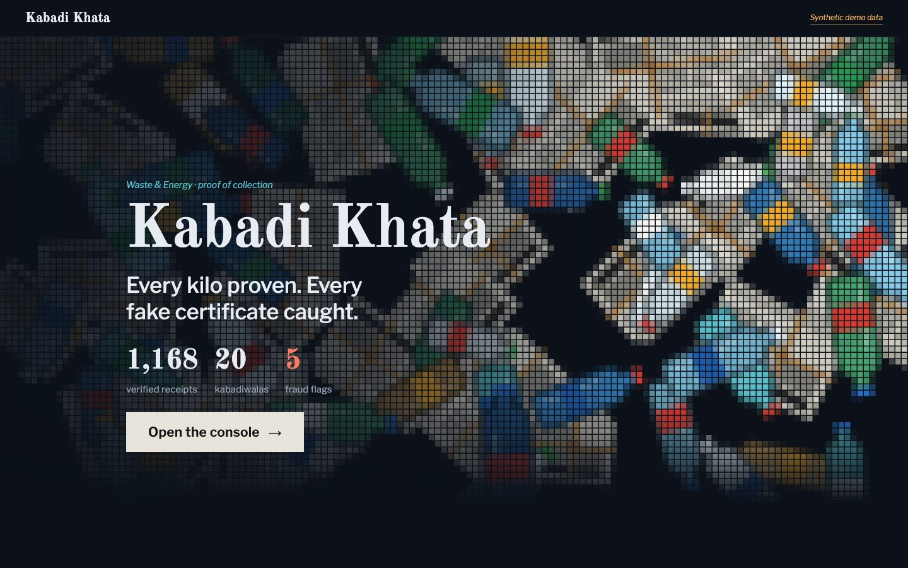
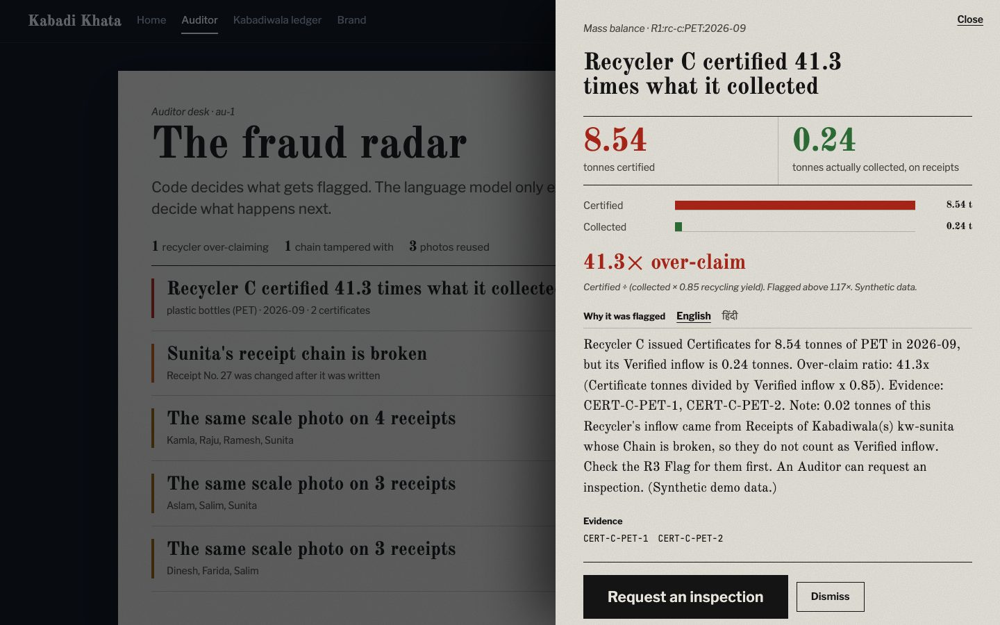
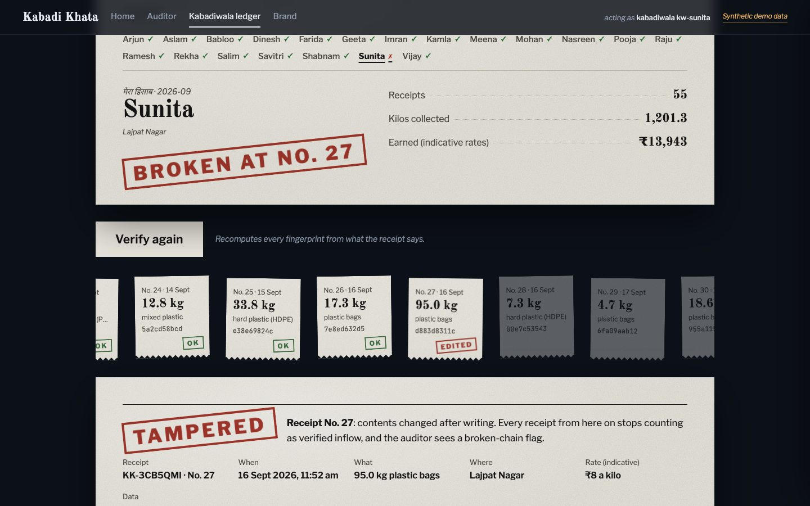
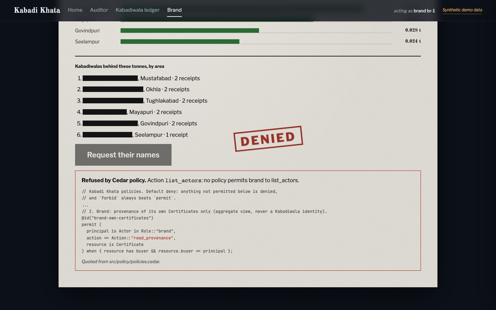
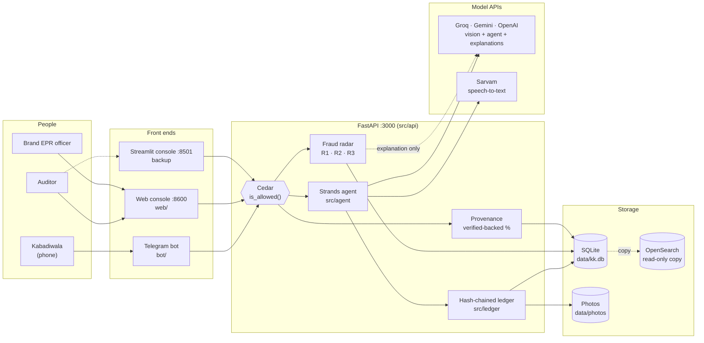
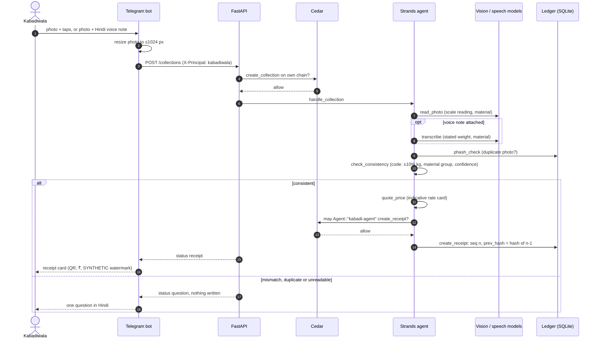
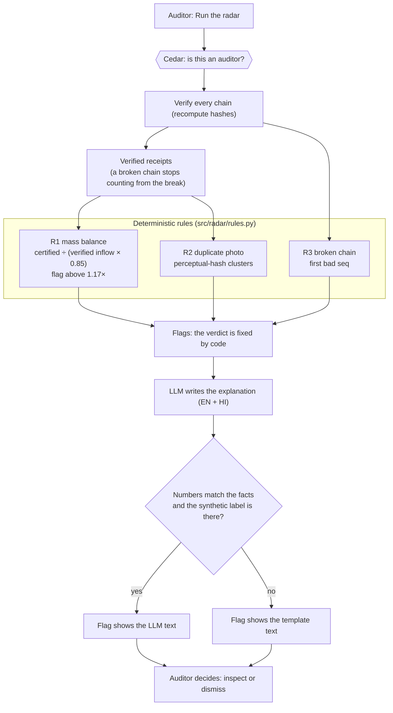
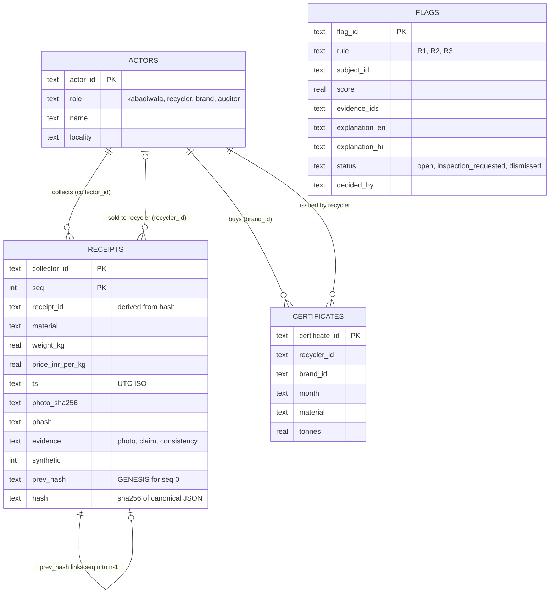
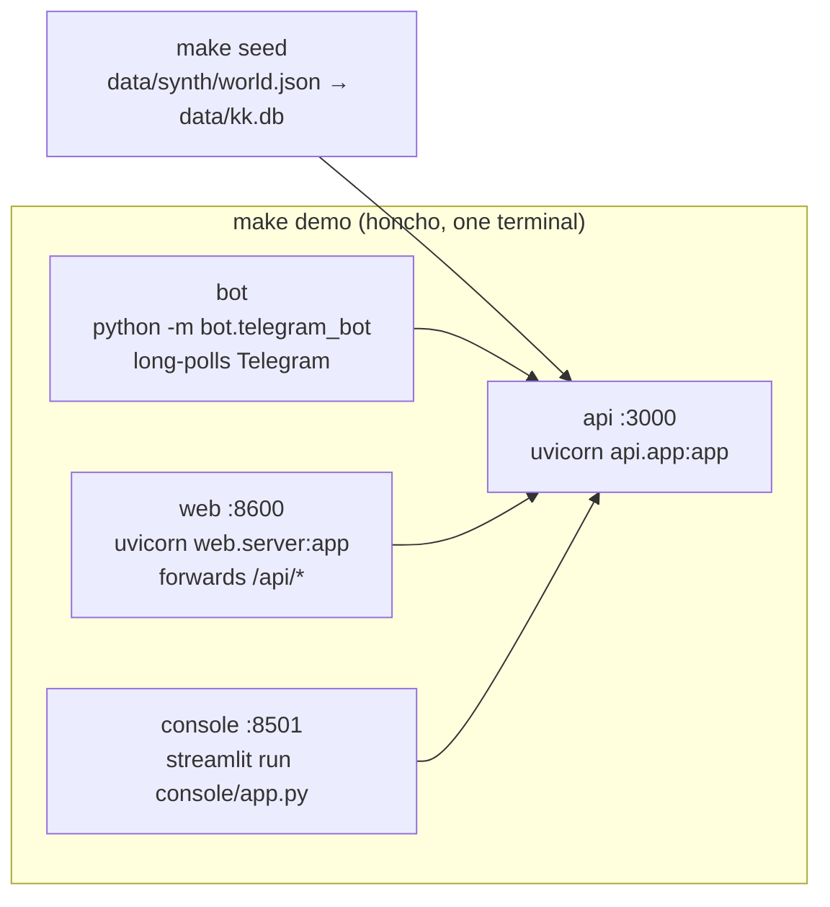
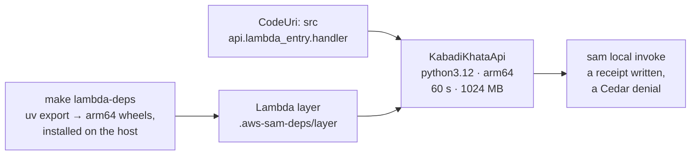

<!-- prettier-ignore -->
<div align="center">

# Kabadi Khata

**Proof of collection for India's informal recyclers, and a fraud radar for EPR certificates.**

<a href="#overview"></a>
<a href="#getting-started"></a>
<a href="pyproject.toml"></a>
<a href="#built-on-aws-open-source"></a>

[Overview](#overview) • [Features](#features) • [How it works](#how-it-works) • [Getting started](#getting-started) • [Evaluation](#evaluation) • [Credits](#credits-and-licences)



</div>

Our entry for **Environmental Hacks** (WeMakeDevs × AWS Bharat Builds Tour), **Waste & Energy** track, **Build It** category: everything runs locally on open-source AWS tools, with no AWS account.

## Overview

> In 2024, the NGT took up CPCB's finding of 6 lakh fake recycling (EPR) certificates from four plastic recyclers.
>
> Source: [NGT notice, CPCB/MoEFCC, July 2024](https://www.scconline.com/blog/post/2024/07/31/ngt-issues-notice-cpcb-moefcc-recovery-of-6-lakh-fake-epr-certificates-from-plastic-recycling-companies/)

Every one of those certificates claims plastic that a collector like Raju picked up, and nobody can prove who actually collected it. Kabadi Khata lets a kabadiwala prove a collection with one photo and a voice note, and catches the recyclers who certify more than they ever received.

It serves three people (see [`docs/personas.md`](docs/personas.md)):

- **Raju, the kabadiwala**, gets a tamper-evident receipt for every collection and a monthly income statement he can show a lender.
- **The auditor** runs a deterministic fraud radar over recycler data and decides which flags become inspections.
- **Priya, the brand's EPR officer**, sees how much of each certificate is backed by verified receipts, but never the collectors' identities.

> [!NOTE]
> **WhatsApp in production; Telegram for the prototype.** Telegram needs no business approval and runs fully locally for Build It. WhatsApp is the production direction, not part of this build.

## Features

| | |
|---|---|
| **A receipt, or one question** | A kabadiwala sends a photo of the scale, then taps the material and weight or sends a Hindi voice note. A Strands agent checks that the photo and the claim agree. If they do, it writes **one hash-chained receipt** and sends back a receipt card. If not, it asks **one question in Hindi and writes nothing**. |
| **Fraud caught by rules, explained by an LLM** | The radar's verdicts come from deterministic rules (`src/radar/rules.py`): R1 mass balance, R2 duplicate photos, R3 broken chains. The LLM only writes the explanation, in English and Hindi. The auditor approves the inspection. |
| **Tampering breaks the chain** | Each receipt's hash covers every field and the previous receipt's hash. Edit any stored receipt and `/verify` reports the exact position where the chain breaks. Corrections are new entries, never edits. |
| **Privacy by policy** | Cedar authorises every API call and the agent's one write tool. A brand sees each certificate's **verified-backed %** and its supply by locality, and is refused the kabadiwalas' names. |
| **Proof of income** | `/hisaab` in the bot returns a shareable income statement image (month, receipts, kg, ₹, chain verified, QR code to the verify endpoint), framed as proof of income for micro-loans such as PM SVANidhi. Prices are labelled **indicative**. |

<table>
<tr>
<td width="50%"><br><sub><b>Auditor:</b> the radar flags Recycler C; the auditor can request an inspection.</sub></td>
<td width="50%"><br><sub><b>Ledger:</b> verifying a tampered chain shows exactly which receipt was edited.</sub></td>
</tr>
<tr>
<td colspan="2"><br><sub><b>Brand:</b> supply is shown by locality; asking for names is refused by Cedar, and the page quotes the policy.</sub></td>
</tr>
</table>

## How it works

### High-level design

Three people, three front ends, one API. Every request passes Cedar before it touches data, and the ledger in SQLite is the only system of record.



### Low-level design: one collection

The agent picks the tools and phrases the reply; code decides the outcome. `create_receipt` is the only write tool, and it refuses unless the consistency check passed **and** Cedar allows `Agent::"kabadi-agent"` to write.



If a model call fails or times out, the agent run stops and code finishes the collection deterministically, so the demo never depends on the model answering.

### Low-level design: the fraud radar



### Data model



### Runtime and build artifacts

`make demo` runs every process locally from the `Procfile`:



`make sam-invoke` packages the same API as an arm64 Lambda for the "Built on AWS" clip:



### Design rules

1. **Code decides, the human approves, the LLM explains.** No model ever decides a verdict or a receipt.
2. **The agent has exactly one write tool,** `create_receipt`, and it refuses unless the consistency check passed **and** Cedar allows it.
3. **Determinism for the demo:** temperature 0, a disk cache keyed by input hash, and a `MOCK_LLM=1` replay mode.

### Built on AWS (open source)

| Tool | Role here |
|---|---|
| **Strands Agents** | The collection agent and its tools, with one guarded write tool (`create_receipt`). |
| **Cedar** | Authorises every API call and the agent's write; denies brands the collectors' identities. |
| **SAM CLI** (`sam local invoke`) | `template.yaml` runs the same app as an arm64 Lambda; `make sam-invoke` writes a receipt and shows a Cedar denial. |
| **OpenSearch** | Read-only search copy of the ledger for the auditor ([ADR 0002](docs/adr/0002-opensearch-as-read-only-search-copy.md)). SQLite stays the system of record. |

The demo runs on **FastAPI + SQLite** by design ([ADR 0001](docs/adr/0001-fastapi-sqlite-demo-stack.md)); nothing in the demo path depends on OpenSearch. Models run through Strands' non-Bedrock providers: Google Gemini, OpenAI or Groq.

## Getting started

You need [uv](https://docs.astral.sh/uv/), Python 3.12 and `make` (on Windows: Git Bash or WSL). Docker is only needed for OpenSearch and the SAM step.

```bash
make demo     # creates .env, installs, seeds a synthetic month, then runs the API (:3000),
              # the web console (:8600), the Streamlit console (:8501) and the Telegram bot
make smoke    # in a second terminal: checks every endpoint and the 4 demo beats, then re-seeds
```

Then open **http://localhost:8600** for the landing page and the console (Auditor, Kabadiwala ledger, Brand).

> [!TIP]
> `make demo` works from a fresh clone with **no API keys**: `.env` starts with `MOCK_LLM=1`, which replays scripted model answers. OpenSearch is skipped when Docker isn't running.

### Configuration

Settings live in `.env` (gitignored; copied from [`.env.example`](.env.example) on first run).

| Setting | What it does |
|---|---|
| `MOCK_LLM` | `1` replays scripted answers with no API calls; `0` uses the real models. |
| `LLM_PROVIDER` | Model for the agent and the radar explanations: `gemini`, `openai` or `groq`. |
| `VISION_PROVIDER` | Who reads scale photos first (`gemini`, `openai`, `groq` or `xai`); the others with keys are fallbacks. |
| `GEMINI_API_KEY`, `OPENAI_API_KEY` | Keys for those providers. |
| `GROQ_API_KEYS` | Comma-separated Groq keys; a rate-limited key hands the request to the next one. |
| `SARVAM_API_KEY` | Sarvam speech-to-text for Hindi voice notes. |
| `TELEGRAM_BOT_TOKEN` | The bot's token from @BotFather. Without it, `make demo` runs everything except the bot. |

> [!WARNING]
> Run only **one** bot per token. Two processes polling the same token split Telegram's updates between them, and messages go missing.

### Using the bot

`/start` → pick a language → send a photo of the scale → tap material and kg, or send a Hindi voice note → receipt card. `/demo` toggles a simulated mismatch, and `/hisaab` returns the income statement image.

### Commands

| Command | What it does |
|---|---|
| `make api` · `make web` · `make console` · `make bot` | Run one part at a time. |
| `make seed` | Rebuild `data/kk.db` from the synthetic world (clears radar flags). |
| `make test` | Run the test suite in `MOCK_LLM=1` mode. |
| `make up` · `make down` · `make reindex` | Start or stop OpenSearch, and rebuild its copy from SQLite. |
| `make tamper COLLECTOR=kw-raju SEQ=0 KG=40` | Edit a stored receipt, to show the chain breaking. |
| `make sam-invoke` | Build the API as an arm64 Lambda and run two `sam local invoke`s (a receipt, a Cedar denial). |
| `make redteam` | Rebuild the agent's red-team scorecard ([`docs/redteam_scorecard.md`](docs/redteam_scorecard.md)). |

Endpoint and Cedar action reference: [`src/api/README.md`](src/api/README.md). Recording the demo video: [`docs/recording_runbook.md`](docs/recording_runbook.md).

## Evaluation

Everything below is measured on **synthetic** data and says so. Scripts and full tables are in [`eval/`](eval).

**Fraud radar** ([`eval/radar_eval.py`](eval/radar_eval.py), [`RESULTS_radar.md`](eval/RESULTS_radar.md)). 20 random 3-month worlds: 6 honest recyclers whose certificates vary ±15% month to month, and one fraudulent recycler each at 1.2×, 1.5×, 3× and 38×. The rules are the real ones in `src/radar/rules.py` (R1 threshold 1.17).

- **Smallest over-claim caught every time with zero false flags on honest recyclers: 1.5×** (0 of 1,440 honest recycler-months flagged).
- 1.2× is caught 62% of the time; 3× and 38× every time. R1 precision 99%, recall 91%. R2 (duplicate photos) and R3 (broken chain) find every planted case.
- When a chain is tampered, its later receipts stop counting as verified inflow, so an honest recycler that bought from that kabadiwala can be flagged that month. That is the rule working as designed and is reported separately.

**Voice → stated weight** ([`eval/voice_eval.py`](eval/voice_eval.py), [`RESULTS_voice_sarvam.md`](eval/RESULTS_voice_sarvam.md)). Sarvam Saaras writes the transcript; code (`src/perception/hinglish.py`) reads the weight and material from it. 30 scripted Hindi/Hinglish lines (fractions like *dedh* and *saadhe teen*, every material, one prompt-injection line):

- **Weight right on 64 of 64 synthetic clips.**
- Material right on 30/30 clips in Sarvam Bulbul voices, 28/30 in the macOS Hindi voice, 3/4 in Gemini voices.
- **Real voice notes from a team member (WhatsApp): weight and material right on 3 of 3.** n is small, so it is reported as 3/3, not a percentage.
- The other 5 script lines, spoken in that team member's cloned voice (Sarvam voice cloning; synthetic, and from the same vendor as the transcriber, so an easier test than real phone audio; never counted as real): 5 of 5, including the prompt-injection line, which stays a stated weight to check, not an instruction.

**Photo → scale reading** ([`eval/photo_eval.py`](eval/photo_eval.py), [`RESULTS_photo_heldout_groq.md`](eval/RESULTS_photo_heldout_groq.md), scored once on the held-out split). The team's 30 AI-generated kabadi scale images ([Kaggle](https://www.kaggle.com/datasets/oneshikaaa/kabadiwala)), split 20 for tuning and 10 held out, labelled by a person. Read by Groq `qwen/qwen3.8-27b` (prompt v4); n = 10, 6 with a readable dial:

- **kg within ±5%: 2 of 6.** Within ±5% or ±1 kg (about one dial tick): 4 of 6. One large miss (25 kg read as 1.5).
- **Material right: 9 of 10.**
- 4 of the held-out dials were garbled by the image generator; the model refused only 1 of them. Shown a broken dial, it "corrects" the printed numbers and reads it anyway.

> [!NOTE]
> This is why the photo reading is never trusted alone. The agent writes a receipt only when the scale reading and the kabadiwala's stated weight (taps or voice) agree within 10%; otherwise it asks one question in Hindi and writes nothing. A misread photo costs a question, not a false receipt.

## Repository layout

```
bot/       Telegram bot: conversation, receipt and income cards, Hindi strings
web/       Web front end: landing page and console (plain HTML/CSS/JS) + a forwarding server
console/   Streamlit console (backup): auditor and brand views
src/       agent · perception · policy (Cedar) · ledger (hash chain) · radar · api · search · synth
eval/      radar, voice and photo evaluations, with results
data/      synthetic world, localities, indicative rate card, eval labels
docs/      personas, demo script, recording runbook, ADRs, red-team scorecard
tests/     pytest suite (make test)
```

Contributor rules: [`CLAUDE.md`](CLAUDE.md). Vocabulary used in code, UI and the video: [`CONTEXT.md`](CONTEXT.md). Background research: [`research/00_SHORTLIST.md`](research/00_SHORTLIST.md) and `research/01` to `04`.

## Credits and licences

- **Libraries:** python-telegram-bot, Pillow, qrcode, pydub, Streamlit, pandas, FastAPI, Uvicorn, Mangum, opensearch-py, httpx, honcho, Strands Agents, OpenAI Python SDK (the client for Groq's OpenAI-compatible API), cedarpy (see each project's licence). OpenSearch runs from the `opensearchproject/opensearch` image (Apache-2.0).
- **Fonts:** the web front end loads Old Standard TT, Libre Franklin and JetBrains Mono from Google Fonts (SIL Open Font License). The bot's cards bundle no fonts; they render with the OS system font at runtime (Segoe UI/Arial on Windows, DejaVu on Linux, Pillow's built-in default if none is found).
- **Web images:** `web/img/kabadiwala.jpg`, `kabadiwala-close.jpg` and `raddi.jpg` are AI-generated (Google Gemini). The landing page's two newspaper clippings quote their sources on the page: SCC Online (31 July 2024) and Mongabay India (May 2026).
- **Eval photos:** "kabadiwala" dataset by the team (Apache-2.0), [kaggle.com/datasets/oneshikaaa/kabadiwala](https://www.kaggle.com/datasets/oneshikaaa/kabadiwala). AI-generated images (made with Google's Nano Banana image model), labelled synthetic.
- **Speech:** [Sarvam AI](https://www.sarvam.ai) Saaras (speech-to-text, used by `transcribe`), Bulbul (text-to-speech, synthetic eval clips) and voice cloning (synthetic clips in a team member's voice, with their recordings) via their API; the macOS "Lekha" Hindi voice for more synthetic clips.
- **Look-alike photo check (optional `dedupe` extra, measure-only):** [DINOv2-small](https://huggingface.co/facebook/dinov2-small) by Meta AI (Apache-2.0), ONNX export by [onnx-community](https://huggingface.co/onnx-community/dinov2-small); [ONNX Runtime](https://onnxruntime.ai) (MIT) and NumPy (BSD-3-Clause).
- **Vision:** [Groq](https://groq.com) serving `qwen/qwen3.8-27b` reads the scale photo, with Google Gemini (`gemini-flash-latest`, via the `google-genai` SDK) as the fallback; OpenAI and xAI Grok are optional further fallbacks. Gemini is also the fallback transcriber.
- **Screenshots** in `docs/screenshots/` show the web console running on the synthetic demo world.
