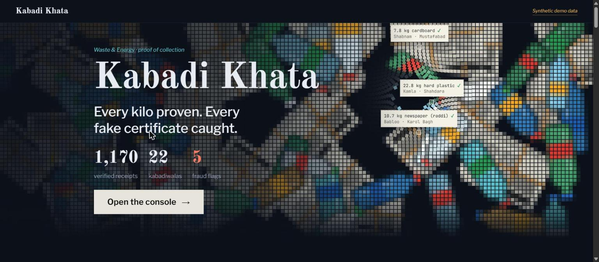
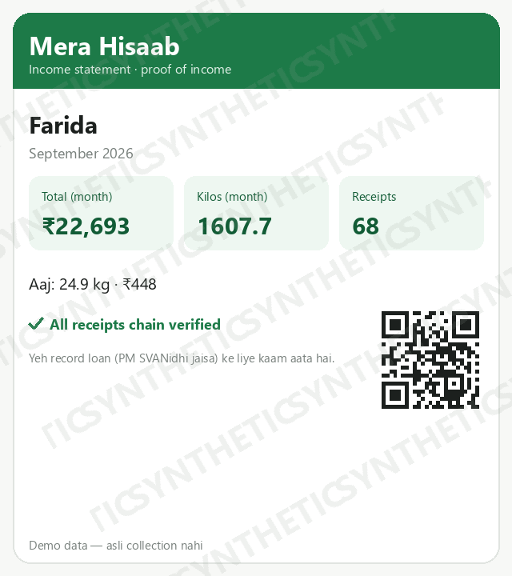
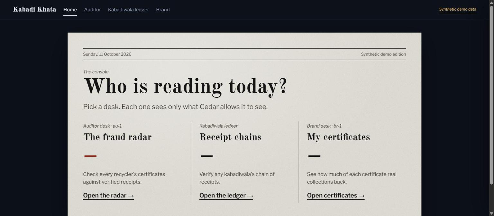

# Kabadi Khata, Part 1: putting every kilo of India's scrap on paper

*By [your name] · Part 1 of the Kabadi Khata series, built for Environmental Hacks (WeMakeDevs × AWS Bharat Builds Tour), Waste & Energy track, Build It mode.*

> **Kabadi Khata** is a tamper-evident proof-of-collection system for kabadiwalas,
> and a fraud radar for the EPR recycling certificates sold on top of their work.
> This post is the problem and the product. The other three go under the hood.

**The series (4 parts):**
1. **The problem, and the product** — this post
2. Perception: reading a photo and a Hindi voice note — [link]
3. The agent and the policy layer — [link]
4. The ledger and the fraud radar — [link]

## The problem, from both ends

Look at the two ends of India's recycling chain.

At the collection end is the kabadiwala. She buys bottles, newspaper, tin and
cardboard by hand, weighs them on a spring scale, and is paid by the kilo in cash.
Nothing is written down. No receipt means no proof of what she earns — so no bank
can see her work and no loan officer can price her. And newer waste rules push
formal players to work only with *registered* collectors, which quietly writes her
out.

At the other end is the certificate. Under India's EPR (Extended Producer
Responsibility) regime, recyclers issue certificates that brands buy to prove
they've offset their plastic. And here is the fact that set our direction:

> In 2024, the NGT took up CPCB's finding of 6 lakh fake recycling (EPR)
> certificates from four plastic recyclers.

*(Source: SCC Online, 31 July 2024 — NGT notice to CPCB and MoEFCC.)*

So: at the bottom, real work that leaves no record. At the top, records with no
real work behind them. Kabadi Khata attacks both — it makes the collector's work
provable, and it makes a fake certificate catchable.

## What the product actually feels like

A kabadiwala opens a Telegram bot, sends a photo of the scale, and either taps a
couple of buttons or sends a short Hindi voice note. A few seconds later she gets
back a **receipt card** — material, weight, an indicative price, and a short chain
hash with a "chain verified" tick. If the photo and the voice note don't agree,
she gets one question in Hindi instead, and nothing is written. (The *how* of that
is Parts 2 and 3.)

She also gets a reason to care that has nothing to do with auditing recyclers. The
**मेरा हिसाब** ("my account") button returns a shareable image: her name, the
month, receipt count, total kilos, total rupees, chain-verified, and a QR code to
the verify endpoint. It's not a rate card — it's proof of income, the kind a
micro-loan officer (think PM SVANidhi) can act on. The pitch to her isn't "help us
catch fraud." It's "here is paper that says you earn."

On the other side of the same data is a console for the people who need to trust
it — an auditor who runs the fraud radar, and a brand that checks how much of a
certificate is actually backed by real receipts.

## Product decisions we made on purpose

- **WhatsApp in production, Telegram for the prototype.** WhatsApp is where this
  user actually is, but the trial channel we had couldn't send freeform WhatsApp
  messages in time. Rather than fake it, we shipped the identical flow on Telegram
  and said so plainly.
- **Only build what's in the demo.** With two build days, anything that wouldn't
  appear in the three-minute video waited. That rule killed a lot of tempting
  scope.
- **Label every synthetic thing as synthetic** — in the data, in the UI (watermarks
  and badges), and on screen. Every figure you see here is demo data.

The honest framing matters for the one number people will remember: a **38×**
over-claim shows up in our demo (rendered as 41.3× in the console). That is **our
own simulated fraud case**, built to make the radar fire hard — not a CPCB finding
and not a specific scandal. The only real-world number we cite is the NGT / 6 lakh
line above.

Next: how the agent actually reads a blurry scale photo and a Hindi voice note,
and why it sometimes refuses. → *Part 2.*

---
*All figures and data shown here are synthetic demo data.*
