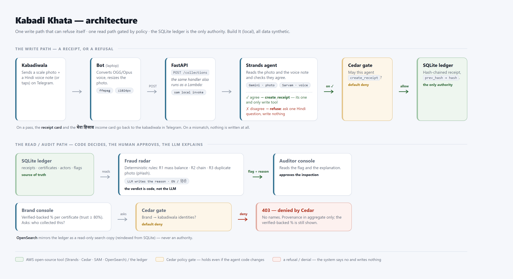
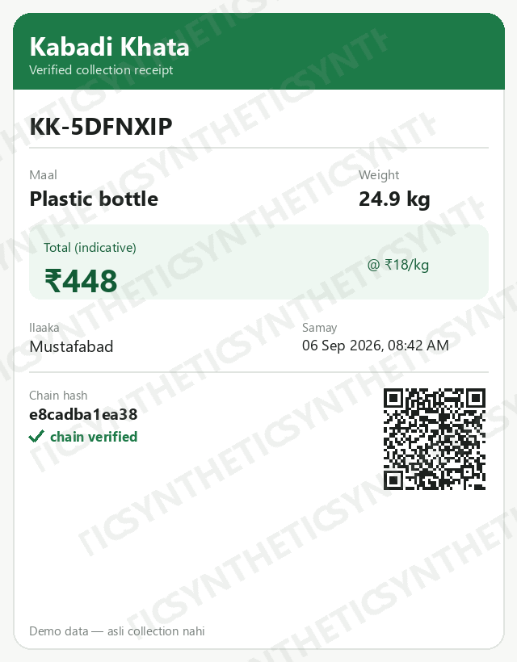

# Kabadi Khata, Part 2: reading a scale photo and a Hindi voice note — and knowing when to say no

*By [your name] · Part 2 of the Kabadi Khata series, built for Environmental Hacks (WeMakeDevs × AWS Bharat Builds Tour), Waste & Energy track, Build It mode.*

> **Kabadi Khata** gives a kabadiwala a tamper-evident receipt and gives auditors a
> fraud radar for recycling certificates. This post is about perception — turning a
> photo of a scale and a Hindi voice note into a number we're willing to write
> down, and refusing when we can't.

**The series (4 parts):**
1. The problem, and the product — [link]
2. **Perception: reading a photo and a Hindi voice note** — this post
3. The agent and the policy layer — [link]
4. The ledger and the fraud radar — [link]

## Two noisy signals, one decision

A collection comes in as two things: a photo of a hand scale, and a short Hindi
voice note (or a couple of button taps). Neither is clean on its own. The dial can
be blurry, glare-washed, or half out of frame. The voice note is fast, colloquial
Hindi with code-switching and background noise.

We read them with two different models, each pointed at what it's good at:

- **Photo → Gemini.** It reads the material and the weight off the dial.
- **Voice → Sarvam.** It transcribes the Hindi, from which we pull the spoken
  weight and material.

Then comes the part that actually matters: the two readings have to **agree**. The
weight from the photo and the weight from the voice note must be within tolerance,
and the material has to match. If they do, the collection is consistent and the
agent is allowed to write a receipt (Part 3). If they don't, we write nothing.

## Fail closed, on purpose

The most important design choice in perception is what happens when the signal is
bad. An unreadable dial does **not** become a confident guess. If the weight comes
back as `None`, or confidence drops below our threshold, the agent doesn't write a
shaky receipt — it asks, in Hindi, for a clearer photo ("तराज़ू का नंबर साफ नहीं…").

That looks like a failure. It's the opposite. A receipt is a claim of truth that
goes into a hash chain and gets shown to auditors and brands. A wrong receipt is
worse than a missing one. So perception fails *closed*: when in doubt, refuse and
ask again.

This is where the photo and voice cross-check pays off. A single model can be
confidently wrong. Two independent reads that have to agree turn "the model thinks
it's 12 kg" into "two signals say 12 kg, so write it" or "they disagree, so ask."

## Measuring it honestly

The trap with a demo is tuning your prompts on the same photos you grade yourself
on. So we split our own photos into a tuning set and a **held-out set**, tuned the
prompts only on the tuning photos, and reported accuracy — weight within tolerance,
and material correct — **on the held-out set only**, stating how many photos that
was. Numbers you can't peek your way to are the only ones worth quoting.

## Making it deterministic

A demo that behaves differently each run isn't a demo, it's a gamble. So:

- **Temperature 0** everywhere.
- A **disk cache keyed by the input's SHA-256**, so the same photo and voice always
  produce the same reading.
- A **`MOCK_LLM` replay mode** for tests and rate-limit emergencies, where
  perception reads from fixtures instead of calling a provider.

Everything runs on non-Bedrock providers (this is Build It mode — no AWS account,
no Bedrock), with the model passed explicitly every time.

Next: what the agent does with a consistent read, why it has exactly one write
tool, and the policy layer that stops it even if its own code changes. → *Part 3.*

---
*All figures and data shown here are synthetic demo data.*
