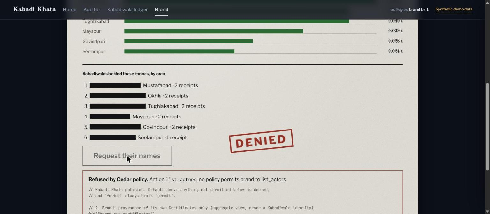
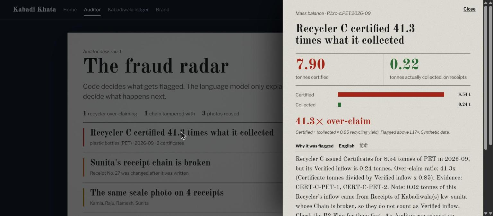

# Kabadi Khata, Part 3: one write tool, two gates — an agent that refuses, and a policy that holds

*By [your name] · Part 3 of the Kabadi Khata series, built for Environmental Hacks (WeMakeDevs × AWS Bharat Builds Tour), Waste & Energy track, Build It mode.*

> **Kabadi Khata** gives a kabadiwala a tamper-evident receipt and gives auditors a
> fraud radar for recycling certificates. This post is about the agent that writes
> the receipt, and the policy layer that decides who is allowed to do what.

**The series (4 parts):**
1. The problem, and the product — [link]
2. Perception: reading a photo and a Hindi voice note — [link]
3. **The agent and the policy layer** — this post
4. The ledger and the fraud radar — [link]

## The rule everything is built around

**Code decides, the human approves, the LLM explains.**

We never let a model be the thing that accuses a recycler or silently writes a
record. The model's judgment is kept to the two places it's good at: reading messy
input (Part 2) and writing a sentence a human can read. Every decision with
consequences is made by deterministic code or by a person.

## The agent has exactly one write tool

Our Strands agent can do exactly one thing that changes the world: call
`create_receipt`. And it refuses to call it unless **two independent conditions**
are both true:

1. the consistency check returned `ok` (the photo and the voice note agree), **and**
2. the policy layer allows *this* agent to `create_receipt`.

The first condition is logic inside the agent. The second is the important one,
because it sits *outside* the agent. That's the whole point: it's the layer that
holds **even if the agent's code changes** — a refactor, a prompt-injection, a bug
that makes the agent want to write when it shouldn't. The policy still says no.

## The policy layer: Cedar, default deny

That outside layer is **Cedar**. Every API handler calls `is_allowed(principal,
action, resource, context)` *before* it touches data, and Cedar is **default
deny** — anything not explicitly permitted is refused, and a `forbid` always beats
a `permit`. A denied request comes back as an HTTP 403 with
`{"denied_by": "cedar", ...}`, which the console renders as a red "Denied by Cedar
policy" banner.

One detail that bit us and is worth sharing: policies that compare a resource's
owner to the caller only work if both are **entity references**, not plain strings.
`Receipt.collector` and `Certificate.buyer` have to be `Actor::"<id>"`, built from
the ledger, or a rule like `resource.collector == principal` never matches. We
build those entities from the SQLite store; the search copy is never an authority.

## What a denial looks like

The sharpest demo of this isn't the agent — it's a brand. A brand can see how much
of a certificate is backed by real receipts (that's Part 4), and it can see
provenance *in aggregate*. But when it asks for the actual identities of the
kabadiwalas behind those tonnes, Cedar says no. Not because of an `if` statement in
the brand page — because no policy permits a brand to list actors.

And when the agent *does* get to write, the fraud radar on the other side still
leans on the same rule — the verdict is computed by code; the LLM only turns the
numbers into an explanation the auditor can read, in English and हिंदी.

Present Cedar as the policy layer that holds even if the agent code changes — not as
a second, independent brain checking the first. That framing is the security story.

Next: the ledger those receipts live in, how tampering with one breaks the chain,
and the deterministic rules that catch an over-claiming recycler. → *Part 4.*

---
*All figures and data shown here are synthetic demo data.*
