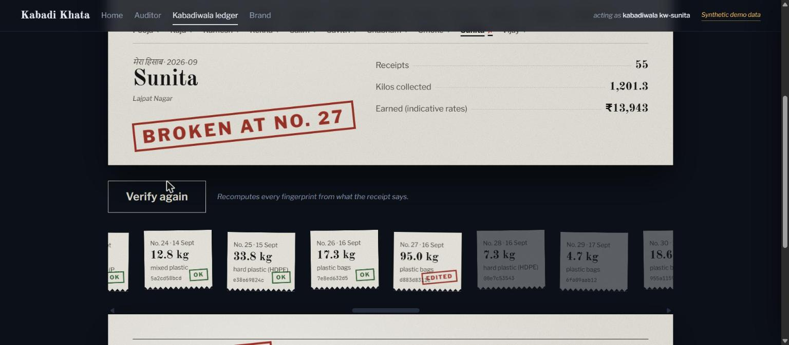
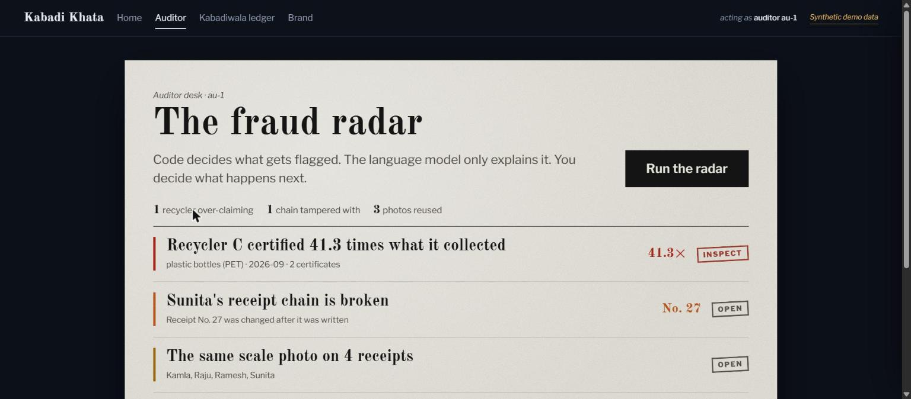
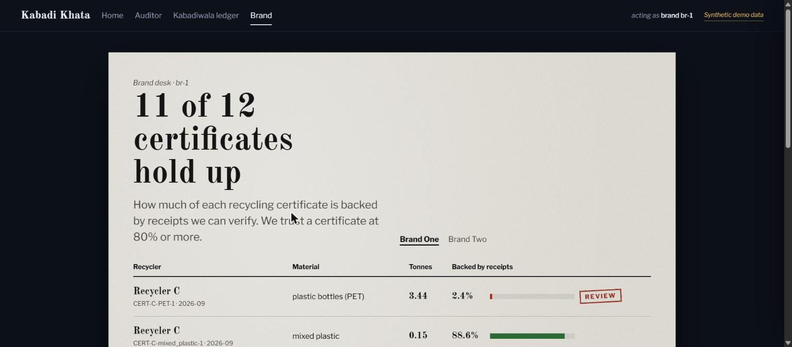

# Kabadi Khata, Part 4: a hash chain that breaks on tamper, and a radar that catches a 41× over-claim

*By [your name] · Part 4 of the Kabadi Khata series, built for Environmental Hacks (WeMakeDevs × AWS Bharat Builds Tour), Waste & Energy track, Build It mode.*

> **Kabadi Khata** gives a kabadiwala a tamper-evident receipt and gives auditors a
> fraud radar for recycling certificates. This post is the data layer — the
> hash-chained ledger the receipts live in, and the deterministic rules that catch a
> recycler certifying far more than it collected.

**The series (4 parts):**
1. The problem, and the product — [link]
2. Perception: reading a photo and a Hindi voice note — [link]
3. The agent and the policy layer — [link]
4. **The ledger and the fraud radar** — this post

## The ledger: a hash chain, not a database row

Every receipt is linked to the one before it. We take the receipt's canonical JSON
— sorted keys, a fixed float format, UTC ISO timestamps — hash it together with the
previous receipt's hash, and store that. The first receipt in a collector's chain
has `prev_hash = "GENESIS"`. Change any field of any past receipt and its hash no
longer matches what the next receipt recorded, so the chain breaks *at that point*
and stays broken for everything after it.

`verify(collector_id)` walks the chain and returns the **first broken sequence
number**. That's the whole tamper-evidence story: you don't have to trust that
nobody edited the ledger — you can check, and the check points at exactly where.

SQLite is the ledger and the only authority. **OpenSearch** is kept as a read-only
search copy, reindexed from SQLite — handy for queries, never trusted to decide
anything.

## The fraud radar: code decides, the LLM explains

On top of the same data runs the fraud radar. The verdicts are **deterministic
rules**, not a model's opinion:

- **R1 — mass balance:** can a recycler's certified tonnage be backed by what it
  actually collected, allowing for a recycling yield? If certified ÷ (collected ×
  yield) is far above 1, it's over-claiming.
- **R2 — chain integrity:** is any collector's receipt chain broken?
- **R3 — duplicate photo:** is the same scale photo reused across receipts
  (perceptual-hash / Hamming distance)?

The radar computes the verdict; the LLM only writes the explanation, in English and
हिंदी; a human auditor reads it and approves the inspection.

## Not a circular 100%

A radar that catches fraud it planted itself proves nothing. So we didn't grade it
that way. We planted fraud at several severities — down to cases only slightly over
the honest range — added realistic month-to-month noise to the *honest* recyclers,
and measured the **smallest over-claim the radar still caught with zero false flags
on the honest recyclers**. That number, not a self-congratulatory 100%, is the one
worth reporting.

> The **38×** case in our demo (shown as a 41.3× over-claim above) is **our own
> simulation**, built to make the radar fire hard — not a CPCB finding and not a
> specific scandal.

## Closing the loop for the buyer

The last piece turns the radar's biggest limitation — it only sees supply that's
inside the system — into a feature a brand can act on. Every certificate carries a
**verified-backed %**: the verified receipt tonnes linked to the recycler, over the
tonnes claimed. A brand sorts its certificates by it and trusts the ones above a
threshold (default 80%). A certificate that's 2.4% backed is a certificate you
don't buy.

That's the full loop: a receipt that can refuse itself, a chain that breaks on
tamper, a radar that catches the over-claim, and a policy layer that decides who
sees what. ← Start the series at *Part 1*.

---
*All figures and data shown here are synthetic demo data.*
